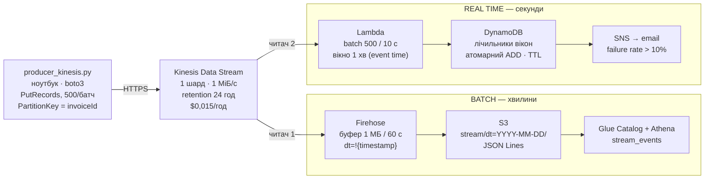

# Частина 4 — Стрімінг у хмарі: Kinesis → Firehose → S3 → Athena + алерт через SNS

## Діаграма




**Звідки беруться дані.** Той самий датасет платежів, що й у частинах 2–3:
один день (`dt=2026-10-01`, 101 084 події, 33 361 платіж) програється з
локального файлу в Kinesis у порядку `receivedAt` із тим самим стисканням часу
(~20 платежів/с, speed factor ≈ 52×). Продукт не міняється навмисно — щоб
локальний і хмарний пайплайни були порівнянними по тих самих числах.

---

## Запуск

```bash
aws login
cd scripts
./setup.sh you@example.com     # ~3 хв: створює все й друкує наступні кроки
# підтвердити підписку SNS у пошті — без цього алерти тихо нікуди не йдуть

python ../producer_kinesis.py \
    --file ../../part3-streaming-local/data/events-2026-10-01.jsonl \
    --stream ooad-lab8-payments --rate 100

aws logs tail /aws/lambda/ooad-lab8-alerting --follow      # дивитися алерти
aws s3 ls s3://<bucket>/stream/ --recursive | head         # за ~2 хв

# Athena: sql/stream_table.sql
./teardown.sh                  # ОБОВʼЯЗКОВО
```

| Файл | Що це |
|---|---|
| [producer_kinesis.py](producer_kinesis.py) | реплей у Kinesis через `PutRecords` |
| [lambda/alert.py](lambda/alert.py) | віконна частка відмов → SNS |
| [scripts/setup.sh](scripts/setup.sh) | усе: стрім, Firehose, Lambda, DynamoDB, SNS, IAM |
| [scripts/teardown.sh](scripts/teardown.sh) | видалити все (шард коштує грошей) |
| [sql/stream_table.sql](sql/stream_table.sql) | таблиця Athena над даними зі стріму |

> Скриншот запиту Athena → [results/athena_stream.md](results/athena_stream.md)

---

## Чим хмарний пайплайн відрізняється від локального Redpanda

### 1. Один стрім — два незалежні читачі

Локально консюмер один, і якби знадобився другий — я б підняв другу групу.
У Kinesis Firehose і Lambda читають **той самий стрім незалежно**, кожен зі
своєю позицією. Це та сама ідея, що consumer groups у Kafka, тільки вона
зашита в сервіс: Firehose — це не код, який я написав, а керована підписка.

Ключова архітектурна річ, яку це дає: **batch і real-time читають одні й ті
самі події**. Не дві копії, не два записи з аплікації — один лог, два
споживачі з різними дедлайнами. Саме це видно на діаграмі частини 1.

### 2. Партиціонування за часом прибуття, а не за часом події

**Це найважливіша відмінність від частини 2.** Firehose підставляє в префікс
`!{timestamp:yyyy-MM-dd}` **приблизний час прибуття запису в стрім** —
processing time. У частині 2 `dt` був **днем події** (перевірено: 0 подій, де
день `modifiedDate` ≠ `dt`).

Наслідок: платіж о 23:59:58, що доїхав о 00:00:03, лягає в **завтрашню**
партицію. Денний звіт по такому `dt` — ніколи не рівно доба бізнесу.

Полагодити можна двома способами, і обидва — це частина 1 у мініатюрі:
- **dynamic partitioning** Firehose із JQ-виразом по `modifiedDate` (+$0,02/ГБ);
- **нічний Glue job**, який перепартиціонує за часом події, — тобто batch-дорога
  існує саме для того, щоб прибирати за streaming-дорогою.

### 3. Часткові відмови — норма, а не виняток

`PutRecords` повертає **HTTP 200** і при цьому поле `FailedRecordCount`.
Задроселений запис — це поле в успішній відповіді, не виняток. Код, який ловить
тільки exceptions, **мовчки втрачає дані**.

Тому в [producer_kinesis.py](producer_kinesis.py) є цикл, що перевідправляє
**тільки відхилені** записи з експоненційним backoff. Перевідправка всього
батчу продублювала б ті, що пройшли.

У Kafka-клієнта цього немає в коді, бо librdkafka/kafka-python ховають усе це
за власною чергою і ретраями. Різниця не в надійності, а в тому, **хто пише цей
код** — ви чи бібліотека.

### 4. Lambda не має стану, і це видно

Локальний консюмер тримає вікна, watermark і множину побачених подій у памʼяті
процесу. Lambda бачить **один батч і помирає**. Хвилинне вікно event time не
влазить у батч: події однієї хвилини приходять у кількох батчах, кількох
інвокаціях і — через паралельне читання шардів — у кількох одночасних
виконаннях.

Тому лічильники винесені в **DynamoDB з атомарним `ADD`**: операція
комутативна, тож паралельні інвокації оновлюють те саме вікно без локів і без
втрати лічби. Повторний алерт на те саме вікно відсікається умовним записом
(`attribute_not_exists(alerted)`).

**Чого Lambda-версія не вміє, а локальний консюмер уміє:**

| | Redpanda + consumer.py | Kinesis + Lambda |
|---|---|---|
| watermark | є, `max(modifiedDate)` | **немає** — це властивість усього стріму, а Lambda бачить фрагмент |
| відкидання запізнілих | є, з `--grace` | **немає** — запис у закрите вікно просто додається |
| гарантія | at-least-once + дедуплікація в памʼяті | at-least-once, **дедуплікації немає взагалі** |
| стан при рестарті | втрачається (тільки офсети) | у DynamoDB, переживає все |
| ціна стану | 0 | round trip на вікно на батч |

Ці три прогалини — не баги, які треба полагодити в `alert.py`. Це **рівно те,
за що платять у Managed Flink**: keyed state у памʼяті поруч із даними,
чекпоінти стану разом з офсетами стріму, справжні watermark-и. Коли на захисті
питають «а чому не зробити все на Lambda» — ось відповідь у трьох рядках.

### 5. Затримка

| | локально | у хмарі |
|---|---:|---:|
| продюсер → брокер | мілісекунди (`linger_ms=50`) | ~20–50 мс (HTTPS) |
| брокер → алерт | мілісекунди | **~10–15 с** (batching window Lambda) |
| брокер → дані в S3 | — | **~60–120 с** (буфер Firehose) |
| дані доступні в SQL | — | + `MSCK REPAIR` |

Локально алерт зʼявляється практично миттєво, бо консюмер — це процес у
сусідньому терміналі. У хмарі мінімум **10 секунд** додає Lambda batching
window (його можна поставити в 0 — ціною інвокації на кожен запис) і **до
хвилини** — буфер Firehose, у якого 60 секунд це *мінімум*, нижче не ставиться.

**Хмара не швидша. Вона масштабованіша.** Redpanda на ноутбуці обробить ці
60 подій/с із меншою затримкою, ніж уся ця конструкція. Різниця починається
на 60 000 подій/с, коли ноутбук закінчується, а Kinesis просто додає шарди.

### 6. Операційна різниця

| | Redpanda локально | Kinesis у хмарі |
|---|---|---|
| підняти | `docker compose up` — 30 с | `setup.sh` — ~3 хв, 2 IAM-ролі, 7 ресурсів |
| що треба знати | Kafka API | IAM, ARN-и, trust policy, event source mapping |
| масштабування | `--smp`, партиції вручну | `update-shard-count`, автоматично |
| коли падає | видно в терміналі | CloudWatch Logs, три різні лог-групи |
| ціна помилки | нуль | шард цокає $0,015/год, поки не видалиш |
| забути вимкнути | нічого не станеться | **$11/міс** |

Половина [setup.sh](scripts/setup.sh) — це IAM. Це чесна ціна керованих
сервісів: вони не треба адмініструвати, але треба **описувати права доступу
між ними**.

---

## Скільки це коштувало

Прайс-лист us-east-1. Прогін — одна година, 101 084 записи по ~350 байтів.

| Сервіс | Тариф | Обсяг | Вартість |
|---|---|---|---:|
| Kinesis shard-hour | $0,015 / шард·год | 1 год | **$0,0150** |
| Kinesis PUT payload units | $0,014 / млн | 101 084 (по 1 юніту) | $0,0014 |
| **Firehose ingestion** | $0,029 / ГБ | **0,505 ГБ** (див. нижче) | **$0,0147** |
| S3 PUT | $0,005 / 1000 | ~60 файлів | $0,0003 |
| S3 storage | $0,023 / ГБ·міс | 35 МБ | $0,0008 |
| Lambda | $0,0000166667 / ГБ·с | ~360 інвокацій × 256 МБ | $0,0008 |
| DynamoDB on-demand write | $1,25 / млн | ~4 300 записів | $0,0054 |
| SNS email | перші 1 000 безкоштовно | кілька десятків | $0 |
| Athena | $5 / ТБ, мін. 10 МБ | 5 запитів | $0,0003 |
| CloudWatch Logs | $0,50 / ГБ | ~5 МБ | $0,0025 |
| | | **Разом** | **≈ $0,041** |

### Дві цифри, які варто пояснити

**Firehose: 35 МБ даних, а платимо за 505 МБ.** Firehose округлює **кожен
запис до 5 КБ**. Наші записи по ~350 байтів → `101 084 × 5 КБ = 505 МБ`,
тобто **у 14,4 раза більше за реальний обсяг**. Це найбільша стаття витрат у
таблиці, і вона цілком рукотворна: якби продюсер пакував по 10 платежів в один
запис (~3,5 КБ), рахунок Firehose упав би майже в 10 разів. Дрібні записи в
Firehose — класична помилка, яку видно тільки в рахунку.

**Шард коштує однаково, чи тече щось через нього.** $0,015/год — це
$0,36/добу, **$10,95/місяць** за один шард, який нічого не робить. Саме тому
`teardown.sh` і попередження в завданні. Для порівняння: Redpanda в Docker за
той самий місяць — $0.

### Якщо масштабувати до справжнього навантаження

| | наш прогін | 3 млн подій/добу (весь датасет) |
|---|---:|---:|
| Kinesis шардів | 1 | 1 (35 подій/с — запас 30×) |
| Kinesis / міс | — | $10,95 + $1,26 = **$12,21** |
| Firehose / міс (по 5 КБ) | — | 450 ГБ × $0,029 = **$13,05** |
| Firehose / міс (пакуючи по 10) | — | **$1,36** |
| S3 / міс | — | 32 ГБ × $0,023 = $0,74 |
| Lambda + DynamoDB / міс | — | ≈ $5 |
| **Разом** | **$0,04** | **≈ $31/міс** (або $19 з пакуванням) |

Тридцять доларів на місяць за пайплайн, який самостійно масштабується,
переживає падіння зони і тримає 24-годинний реплей. Еквівалентний self-hosted
Kafka — це мінімум три `t3.medium` у різних AZ ($90/міс) плюс людина, яка їх
обслуговує. **Перелом не в ціні заліза, а в тому, скільки коштує година
інженера.**

> Фактичні витрати звірити в Cost Explorer через добу (білінг відстає) і
> записати в [results/cost.md](results/cost.md).

---

## Що порівняти з частиною 3

Запит 2 у [sql/stream_table.sql](sql/stream_table.sql) рахує ту саму частку
відмов по `paymentMethod`, що й локальний консюмер. Числа мають збігтися —
обидва рахують одне й те саме по тих самих подіях.

Очікувано для `dt=2026-10-01` (виміряно в частині 3):

| paymentMethod | terminal | failures | % |
|---|---:|---:|---:|
| google_pay | 5 843 | 359 | 6,14 |
| apple_pay | 8 412 | 500 | 5,94 |
| card | 18 406 | 1 092 | 5,93 |
| qr | 700 | 39 | 5,57 |

**Якщо Athena покаже менше подій, ніж консюмер** — це не помилка округлення,
а один із трьох реальних розбіжностей, і треба назвати який:

1. продюсера зупинили раніше, ніж він дослав усе;
2. останній буфер Firehose не встиг флашнутися (чекати 60+ с після кінця);
3. записи, які `PutRecords` відхилив, а продюсер здався їх ретраїти — у
   підсумковому виводі це рядок `DROPPED`.

Третя причина — єдина, що є справжньою втратою даних, і саме її в локальному
Redpanda не буває взагалі.
