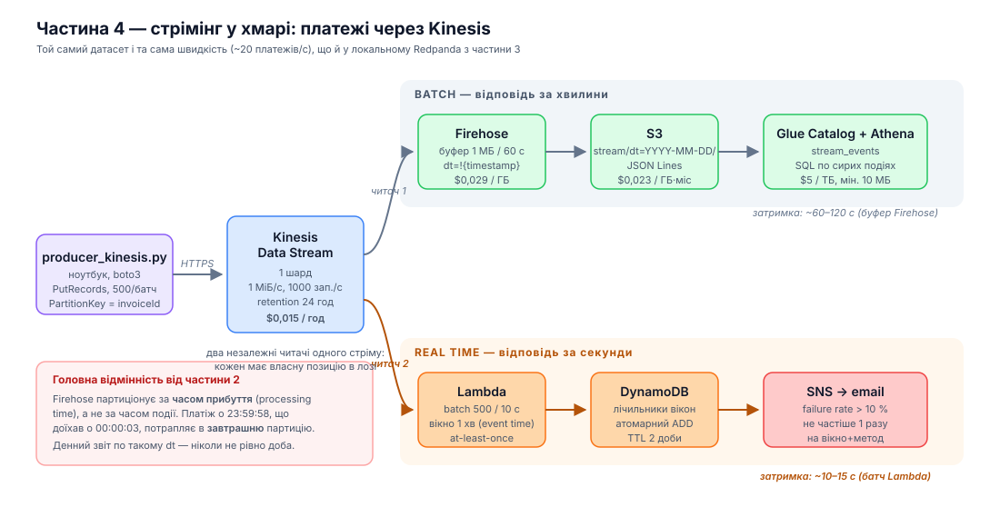
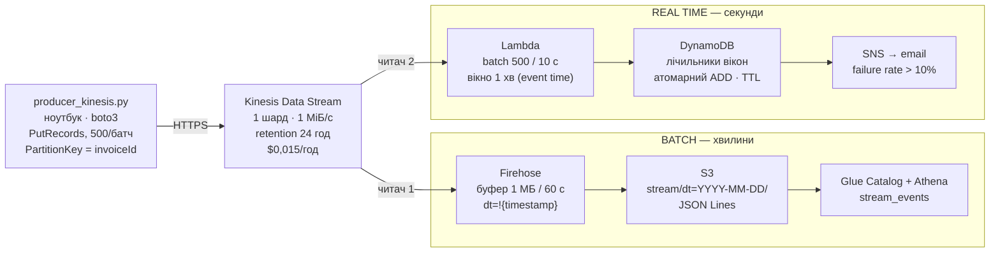

# Частина 4 — Стрімінг у хмарі: Kinesis → Firehose → S3 → Athena + алерт через SNS

## Діаграма





**Звідки беруться дані.** Той самий датасет платежів, що й у частинах 2–3:
один день (`dt=2026-10-01`, 101 084 події, 33 361 платіж) програється з
локального файлу в Kinesis у порядку `receivedAt` із тим самим стисканням часу
(~20 платежів/с, speed factor ≈ 52×). Продукт не міняється навмисно — щоб
локальний і хмарний пайплайни були порівнянними по тих самих числах.

---

## Запуск

```bash
aws login
cd scripts
./setup.sh you@example.com     # ~3 хв: створює все й друкує наступні кроки
# підтвердити підписку SNS у пошті — без цього алерти тихо нікуди не йдуть
# ./setup.sh без аргументу — топік без підписки, алерти видно в логах Lambda

python ../producer_kinesis.py \
    --file ../../part3-streaming-local/data/events-2026-10-01.jsonl \
    --stream ooad-lab8-payments --rate 200 --fail-rate 0.30

aws logs tail /aws/lambda/ooad-lab8-alerting --follow      # дивитися алерти
aws s3 ls s3://<bucket>/stream/ --recursive | head         # за ~2 хв

# Athena: sql/stream_table.sql
./teardown.sh                  # ОБОВʼЯЗКОВО
```

| Файл | Що це |
|---|---|
| [producer_kinesis.py](producer_kinesis.py) | реплей у Kinesis через `PutRecords` |
| [lambda/alert.py](lambda/alert.py) | віконна частка відмов → SNS |
| [scripts/setup.sh](scripts/setup.sh) | усе: стрім, Firehose, Lambda, DynamoDB, SNS, IAM |
| [scripts/teardown.sh](scripts/teardown.sh) | видалити все (шард коштує грошей) |
| [sql/stream_table.sql](sql/stream_table.sql) | таблиця Athena над даними зі стріму |

> Результати запитів Athena → [results/athena_stream.md](results/athena_stream.md)

### Дві пастки, на які варто чекати

**`pip install boto3` недостатньо.** Якщо машина автентифікується через
`aws login`, botocore відмовляється читати ці креденшали без
`botocore[crt]` і падає з `MissingDependencyException` — хоча сам `aws` CLI у
тому ж терміналі працює. Тому в [requirements.txt](requirements.txt) стоїть
саме `botocore[crt]`.

**Копіювання публічного бакета теж має пастку** (частина 2): `aws s3 sync`
за замовчуванням зберігає теги, тобто викликає `GetObjectTagging` на
**джерелі**. Публічний бакет дає `s3:GetObject`, але не `GetObjectTagging`,
і всі 31 копія падають з `AccessDenied`, хоча дані читаються чудово. Лікує
`--copy-props none`.

---

## Чим хмарний пайплайн відрізняється від локального Redpanda

### 1. Один стрім — два незалежні читачі

Локально консюмер один, і якби знадобився другий — я б підняв другу групу.
У Kinesis Firehose і Lambda читають **той самий стрім незалежно**, кожен зі
своєю позицією. Це та сама ідея, що consumer groups у Kafka, тільки вона
зашита в сервіс: Firehose — це не код, який я написав, а керована підписка.

Ключова архітектурна річ, яку це дає: **batch і real-time читають одні й ті
самі події**. Не дві копії, не два записи з аплікації — один лог, два
споживачі з різними дедлайнами. Саме це видно на діаграмі частини 1.

### 2. Партиціонування за часом прибуття, а не за часом події

**Це найважливіша відмінність від частини 2.** Firehose підставляє в префікс
`!{timestamp:yyyy-MM-dd}` **приблизний час прибуття запису в стрім** —
processing time. У частині 2 `dt` був **днем події** (перевірено: 0 подій, де
день `modifiedDate` ≠ `dt`).

Наслідок: платіж о 23:59:58, що доїхав о 00:00:03, лягає в **завтрашню**
партицію. Денний звіт по такому `dt` — ніколи не рівно доба бізнесу.

Полагодити можна двома способами, і обидва — це частина 1 у мініатюрі:
- **dynamic partitioning** Firehose із JQ-виразом по `modifiedDate` (+$0,02/ГБ);
- **нічний Glue job**, який перепартиціонує за часом події, — тобто batch-дорога
  існує саме для того, щоб прибирати за streaming-дорогою.

### 3. Часткові відмови — норма, а не виняток

`PutRecords` повертає **HTTP 200** і при цьому поле `FailedRecordCount`.
Задроселений запис — це поле в успішній відповіді, не виняток. Код, який ловить
тільки exceptions, **мовчки втрачає дані**.

Тому в [producer_kinesis.py](producer_kinesis.py) є цикл, що перевідправляє
**тільки відхилені** записи з експоненційним backoff. Перевідправка всього
батчу продублювала б ті, що пройшли.

У Kafka-клієнта цього немає в коді, бо librdkafka/kafka-python ховають усе це
за власною чергою і ретраями. Різниця не в надійності, а в тому, **хто пише цей
код** — ви чи бібліотека.

### 4. Lambda не має стану, і це видно

Локальний консюмер тримає вікна, watermark і множину побачених подій у памʼяті
процесу. Lambda бачить **один батч і помирає**. Хвилинне вікно event time не
влазить у батч: події однієї хвилини приходять у кількох батчах, кількох
інвокаціях і — через паралельне читання шардів — у кількох одночасних
виконаннях.

Тому лічильники винесені в **DynamoDB з атомарним `ADD`**: операція
комутативна, тож паралельні інвокації оновлюють те саме вікно без локів і без
втрати лічби. Повторний алерт на те саме вікно відсікається умовним записом
(`attribute_not_exists(alerted)`).

**Чого Lambda-версія не вміє, а локальний консюмер уміє:**

| | Redpanda + consumer.py | Kinesis + Lambda |
|---|---|---|
| watermark | є, `max(modifiedDate)` | **немає** — це властивість усього стріму, а Lambda бачить фрагмент |
| відкидання запізнілих | є, з `--grace` | **немає** — запис у закрите вікно просто додається |
| гарантія | at-least-once + дедуплікація в памʼяті | at-least-once, **дедуплікації немає взагалі** |
| стан при рестарті | втрачається (тільки офсети) | у DynamoDB, переживає все |
| ціна стану | 0 | round trip на вікно на батч |

Ці три прогалини — не баги, які треба полагодити в `alert.py`. Це **рівно те,
за що платять у Managed Flink**: keyed state у памʼяті поруч із даними,
чекпоінти стану разом з офсетами стріму, справжні watermark-и. Коли на захисті
питають «а чому не зробити все на Lambda» — ось відповідь у трьох рядках.

### 5. Затримка

| | локально | у хмарі |
|---|---:|---:|
| продюсер → брокер | мілісекунди (`linger_ms=50`) | ~20–50 мс (HTTPS) |
| брокер → алерт | мілісекунди | **~10–15 с** (batching window Lambda) |
| брокер → дані в S3 | — | **~60–120 с** (буфер Firehose) |
| дані доступні в SQL | — | + `MSCK REPAIR` |

Локально алерт зʼявляється практично миттєво, бо консюмер — це процес у
сусідньому терміналі. У хмарі мінімум **10 секунд** додає Lambda batching
window (його можна поставити в 0 — ціною інвокації на кожен запис) і **до
хвилини** — буфер Firehose, у якого 60 секунд це *мінімум*, нижче не ставиться.

**Хмара не швидша. Вона масштабованіша.** Redpanda на ноутбуці обробить ці
60 подій/с із меншою затримкою, ніж уся ця конструкція. Різниця починається
на 60 000 подій/с, коли ноутбук закінчується, а Kinesis просто додає шарди.

### 6. Операційна різниця

| | Redpanda локально | Kinesis у хмарі |
|---|---|---|
| підняти | `docker compose up` — 30 с | `setup.sh` — ~3 хв, 2 IAM-ролі, 7 ресурсів |
| що треба знати | Kafka API | IAM, ARN-и, trust policy, event source mapping |
| масштабування | `--smp`, партиції вручну | `update-shard-count`, автоматично |
| коли падає | видно в терміналі | CloudWatch Logs, три різні лог-групи |
| ціна помилки | нуль | шард цокає $0,015/год, поки не видалиш |
| забути вимкнути | нічого не станеться | **$11/міс** |

Половина [setup.sh](scripts/setup.sh) — це IAM. Це чесна ціна керованих
сервісів: вони не треба адмініструвати, але треба **описувати права доступу
між ними**.

---

## Скільки це коштувало

Метрики — з CloudWatch, прайс-лист us-east-1. Реплей: 101 084 записи,
43,9 МБ, середній запис **433 байти**.

| Сервіс | Тариф | Обсяг | $ |
|---|---|---:|---:|
| Kinesis shard-hour | $0,015 / шард·год | 1 год | **0,0150** |
| **Firehose ingestion** | $0,029 / ГБ | **0,518 ГБ** (після округлення) | **0,0150** |
| **DynamoDB on-demand write** | $1,25 / млн WCU | 6 500 | **0,0081** |
| Kinesis PUT payload units | $0,014 / млн | 101 084 | 0,0014 |
| CloudWatch Logs | $0,50 / ГБ | ≈ 3 МБ | 0,0015 |
| Lambda | $0,0000166667 / ГБ·с | 205 × 1,2 с × 0,25 ГБ | 0,0010 |
| S3 (PUT + storage) | | 41 файл, 42 МБ | 0,0013 |
| Athena | $5 / ТБ, мін. 10 МБ | ≈ 10 запитів | 0,0005 |
| SNS | перші 1 млн безкоштовно | 635 публікацій | 0 |
| | | **Разом** | **≈ $0,044** |

### Три цифри, які варто пояснити

**1. Firehose: 43,9 МБ даних, платимо за 518 МБ.** Firehose округлює **кожен
запис до 5 КБ**. Наші — 433 байти, тобто `5120 / 433 = 11,8×` переплати:
`101 084 × 5 КБ = 518 МБ` замість 43,9 МБ. Якби продюсер пакував по
10 платежів в один запис (~4,3 КБ), ця стаття впала б майже вдесятеро.

**2. DynamoDB дорожчий за Lambda у 8 разів** — $0,0081 проти $0,0010.
**Зберігання стану дорожче за обчислення над ним.** Це прямий аргумент за
Flink: там ті самі лічильники живуть у keyed state у памʼяті воркера й
чекпоінтяться пачкою, а наш Lambda робить ~32 `UpdateItem` на інвокацію —
окремий мережевий похід на кожну комірку вікно×метод.

**3. Шард коштує однаково, чи тече через нього щось.** $0,015/год — це
$10,95/місяць за шард, який нічого не робить. Redpanda в Docker за той самий
місяць — $0.

### Троттлінг: один шард виявився замалим

Два прогони того самого дня, різниця лише в `--rate`:

| | `--rate 150` | `--rate 200` |
|---|---:|---:|
| sent | 101 084 | 101 084 |
| **throttled** | **0** | **69 162** |
| DROPPED | 0 | 0 |
| фактичний темп | **149,8 платежів/с** | **154,1** (замовлено 200) |

Один шард тримає 1 000 записів/с або 1 МіБ/с. При 150 платежах/с це 450
подій/с — із запасом; при 200 середнє вже 600 подій/с, а вечірній пік утричі
щільніший за середнє, і стеля пробивається. **Визначає стелю пік, а не
середнє.**

Жоден запис не втрачено: `PutRecords` повертає **HTTP 200** із полем
`FailedRecordCount`, і цикл у [producer_kinesis.py](producer_kinesis.py)
перевідправляє **тільки відхилені** записи. Ціна троттлінгу — час: 216,5 с
замість 167, тобто фактичні 154 платежі/с замість замовлених 200. Kinesis не
відмовляє, він пригальмовує, і побачити це можна лише в полях відповіді.

### Якщо масштабувати до повного датасету

| | наш реплей | 3 млн подій/добу |
|---|---:|---:|
| Kinesis / міс | — | **$12,21** |
| Firehose / міс (по 5 КБ) | — | **$13,05** |
| Firehose / міс (пакуючи по 10) | — | **$1,36** |
| DynamoDB / міс | — | ≈ $7,30 |
| S3 + Lambda + Athena / міс | — | ≈ $3 |
| **Разом** | **$0,044** | **≈ $36/міс** (або $24 з пакуванням) |

Еквівалентний self-hosted Kafka — мінімум три `t3.medium` у різних AZ
(≈ $90/міс) плюс людина, яка їх обслуговує. **Перелом не в ціні заліза, а в
ціні години інженера.**

Повний розбір: [results/cost.md](results/cost.md).

### Ресурси видалено

`teardown.sh` виконано — Kinesis, Firehose, Lambda, DynamoDB, SNS і обидві
IAM-ролі; перевірено порожніми списками. Свідомо лишені S3 (1,4 ГБ,
**$0,033/міс**) і Glue-каталог (free tier), щоб запити Athena лишалися
відтворюваними.

## Що порівняти з частиною 3 — і що з цього вийшло

Запит 2 у [sql/stream_table.sql](sql/stream_table.sql) рахує ту саму частку
відмов по `paymentMethod`, що й локальний консюмер. Фактичний результат:

| paymentMethod | terminal (стрім) | failures | % | terminal (локально, ч. 3) |
|---|---:|---:|---:|---:|
| apple_pay | 8 412 | 2 896 | 34,43 | **8 412** |
| qr | 700 | 241 | 34,43 | **700** |
| card | 18 406 | 6 336 | 34,42 | **18 406** |
| google_pay | 5 843 | 1 991 | 34,07 | **5 843** |

**Кількість термінальних подій збігається до одиниці.** Батч над даними зі
стріму і стрім-консюмер рахують одне й те саме — відрізняється лише дедлайн,
за яким вони дають відповідь.

Частка 34,1–34,4 % — рівно те, що й має бути при `--fail-rate 0.30`:
`0,30 + 0,70 × 0,0602 = 34,2 %`.

Наскрізний облік теж зійшовся: надіслано 101 084 записи → Athena бачить
**101 084 події, 33 361 платіж, рівно 1 001 дублікат** — стільки ж
дублікатів, скільки їх фізично у вихідному файлі.

### Що могло б не зійтися

Якби Athena показала менше, причин було б рівно три, і варто вміти їх
розрізняти:

1. **продюсера зупинили раніше, ніж він дослав усе** — видно в його ж
   підсумковому рядку `sent`;
2. **останній буфер Firehose не встиг флашнутися** — саме це й сталося в
   процесі: перший запит показав 99 785 подій із `last_event` 23:02, і лише
   через кілька хвилин зʼявилися решта 1 299. Неповний буфер чекає на
   60-секундний інтервал, бо не добирає до 1 МБ. **Це і є «eventual» у
   eventual consistency: дані не загублені, вони ще в буфері**;
3. **записи, які `PutRecords` відхилив, а продюсер здався ретраїти** — рядок
   `DROPPED` у підсумку. Єдина з трьох причин, що є справжньою втратою
   даних, і в локальному Redpanda її не буває взагалі.
